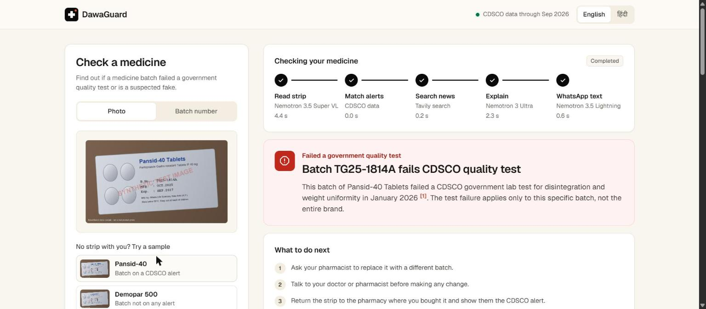
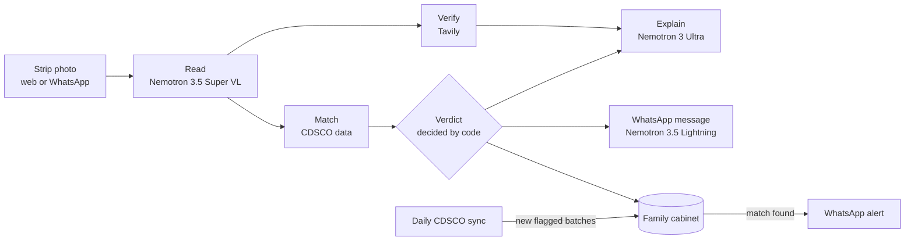

<p align="center">
  
</p>

<p align="center">
  <a href="https://dawaguard-3-7-165-100.sslip.io"><b>Try the live demo</b></a> &nbsp;·&nbsp;
  <a href="#how-it-works">How it works</a> &nbsp;·&nbsp;
  <a href="#nvidia-nemotron-on-nebius-token-factory">Nemotron on Nebius</a> &nbsp;·&nbsp;
  <a href="#run-it-yourself">Run it yourself</a>
</p>

<p align="center">
  
  
  
  
  
  
</p>

**India publishes every medicine batch that fails a government quality test, but nobody checks before taking a tablet.** DawaGuard makes that check take one photo. Send a picture of a medicine strip on WhatsApp or the web, and in about 10 seconds you get:

- **A verdict** from India's official CDSCO alerts: failed a quality test, suspected fake, expired, or not on any alert.
- **What to do next**, in English or Hindi, with the official record cited first.
- **A message ready to forward** to the family WhatsApp group.
- **A watchful cabinet.** Every medicine you check is saved, and DawaGuard messages you if a future CDSCO list flags it.



## Why it matters

Between January 2025 and September 2026, India's drug regulator reported **3,788 batches that failed lab tests and 49 suspected fakes**, including **355 batches of paracetamol**. More than half of the failed batches don't expire until 2027 or later, so they may still be on shelves and in family medicine boxes. The lists are public, but they are long monthly tables on a government website.

## How it works

| | Step | Powered by |
|---|---|---|
| 1 | **Read** brand, ingredients, batch number and expiry from the photo | NVIDIA **Nemotron 3.5 Super VL** |
| 2 | **Match** the batch against every CDSCO flagged batch, tolerant of misreads | Code, on a daily-synced copy of CDSCO data |
| 3 | **Verify** with a search for alerts newer than the monthly lists | **Tavily**, limited to official and pharma-news sites |
| 4 | **Explain** the verdict with citations and safe next steps | NVIDIA **Nemotron 3 Ultra** |
| 5 | **Message** the family in a forwardable WhatsApp text | NVIDIA **Nemotron 3.5 Lightning** (Hindi: Ultra) |
| 6 | **Watch** saved medicines and alert on new CDSCO lists | Code and the WhatsApp Cloud API |

Steps 2–3 and 4–5 run in parallel, and the web page streams each step live with its model, time and token count.

> [!IMPORTANT]
> **The verdict is decided by code, never by a language model.** Code matches the batch (allowing for O/0 and S/5 misreads), confirms the product matches too (batch codes repeat across companies), and checks expiry. Nemotron only reads the photo and explains the decided result. Its prompts forbid changing the verdict, adding facts, calling a medicine "safe", or telling anyone to stop a treatment. Even the emoji in each WhatsApp message is picked by code.



## NVIDIA Nemotron on Nebius Token Factory

Each step uses the smallest Nemotron model that does it well, all through one Token Factory API key and endpoint:

| Model | Job | Why this size |
|---|---|---|
| **Nemotron 3.5 Super VL** | Reads the strip into structured JSON | Batch numbers are tiny print on shiny foil; a capable vision model reads them reliably in 3–4 s |
| **Nemotron 3 Ultra** | Explanation with citations; Hindi messages | Needs real reasoning: cite only supporting sources, keep a batch failure separate from the brand, give safe steps. Its Hindi held up where smaller models drifted into Hinglish |
| **Nemotron 3.5 Lightning** | Short English WhatsApp message | Under a second with thinking off (`enable_thinking: false`), so it finishes alongside the explanation |

Because Token Factory is OpenAI-compatible, switching a step to a different model is one environment variable (`MODEL_VISION`, `MODEL_REASONING`, `MODEL_FAST`), not a new integration. A full photo check takes about 10 seconds on the live server.

## On WhatsApp

- **Check:** send a strip photo, or type a batch such as `TG25-1814A Pansid-40`. A caption like "Papa's BP tablet" becomes the medicine's label.
- **Cabinet:** reply `cabinet` to see every saved medicine with a fresh verdict, `remove 2` to drop one, `हिंदी` or `English` to switch language, and `stop` to delete everything.
- **Alerts:** when the daily CDSCO sync finds new flagged batches, every cabinet is re-checked and the family is messaged once per finding, in words written by code. After WhatsApp's 24-hour window closes, alerts go out as an approved template.
- **Secure by default:** webhooks need a valid Meta signature, and repeat deliveries are answered once.

The demo uses a Meta test number, which only reaches pre-registered phones, so judges can run the same check on the [web demo](https://dawaguard-3-7-165-100.sslip.io); the video shows the WhatsApp flow.

## Run it yourself

Requires Java 21.

```bash
cp .env.example .env   # add NEBIUS_API_KEY and TAVILY_API_KEY
./mvnw spring-boot:run # then open http://localhost:8080 and tap a sample strip
./mvnw test            # 28 tests
```

<details>
<summary><b>API endpoints</b></summary>

- `POST /api/check`: multipart `image`, optional `lang=en|hi`. Photo check, streamed as newline-delimited JSON.
- `POST /api/check/typed`: JSON `{"batchNo": "...", "brandName": "...", "lang": "en"}`. Check a typed batch number.
- `GET /api/status`: loaded CDSCO data and freshness.
- `GET /api/batches/{batchNo}`: look up a batch number.
- `POST /api/demo/cdsco-alert`: header `X-Demo-Token`, body `{"batchNo": "..."}`. Simulates a new CDSCO list containing a saved batch, for demos. The alert says it is simulated, and the simulated row is never stored. Disabled unless `DEMO_TOKEN` is set.
- With `DIAGNOSTICS_ENABLED=true` (local only, spends credits): `GET /api/diagnostics/models` and `GET /api/diagnostics/search`.

</details>

<details>
<summary><b>Deploy with HTTPS and WhatsApp</b></summary>

`deploy/` runs DawaGuard behind Caddy, which obtains the HTTPS certificate that WhatsApp webhooks require. The live demo runs this way on a small AWS server in Mumbai.

```bash
git clone https://github.com/Farhan7-tech/dawaguard && cd dawaguard/deploy
cp ../.env.example .env   # keys, a strong DB_PASSWORD, DAWAGUARD_DOMAIN=your.domain
docker compose up -d --build
```

Then, in your Meta app:
1. Set the webhook to `https://your.domain/webhook/whatsapp` with your `WHATSAPP_VERIFY_TOKEN`, and subscribe to `messages`.
2. Subscribe the app to your WhatsApp Business Account (`POST /<WABA_ID>/subscribed_apps`), or incoming messages go nowhere.
3. With a Meta Sandbox test account, send with the developer's own long-lived user token; a system user token gets error #10.

The database (CDSCO copy and cabinets) lives in the `dawaguard-data` volume.

</details>

## Safety, privacy and limits

- Every paid check is rate-limited per client and per day, so the public demo stays free without running up costs.
- Photos are processed in memory and never stored. WhatsApp numbers are kept only to send cabinet alerts, and `stop` deletes them.
- A failed test applies to that batch, not to the whole brand or manufacturer.
- CDSCO publishes each month's list a few weeks later, so the newest failures may not be listed yet.
- Curved or shiny strips can be misread; DawaGuard shows what it read so you can correct it.
- DawaGuard is a safety check, not medical advice. Never stop a prescribed medicine without talking to a doctor or pharmacist.

**Data:** flagged batches come from CDSCO's public [NSQ and spurious drug alerts](https://cdscoonline.gov.in/CDSCO/viewPublicNSQDrug). A January 2025 to September 2026 snapshot ships in `src/main/resources/seed/`, so the app works even if the CDSCO site is down, and it refreshes daily. The sample strips are synthetic images watermarked as such; the "failed" sample uses a real batch number from CDSCO's January 2026 alert.

<br>

<p align="center">
  
</p>

<p align="center">
  <a href="https://dawaguard-3-7-165-100.sslip.io">Live demo</a> &nbsp;·&nbsp;
  <a href="https://nebiusglobalaihackathon.devpost.com/">Nebius x NVIDIA Global AI Hackathon</a> &nbsp;·&nbsp;
  <a href="LICENSE">MIT License</a> &nbsp;·&nbsp;
  Built by <a href="https://github.com/Farhan7-tech">Mohd Farhan</a>
</p>
