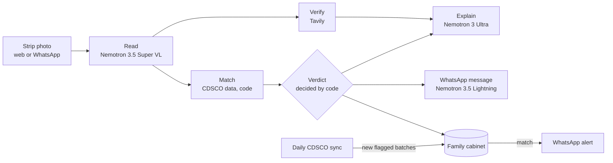

# DawaGuard

**A medicine guardian for Indian families, on WhatsApp and the web.** Send a photo of a medicine strip. DawaGuard reads the batch number and checks it against India's official lists of drug batches that failed government quality tests or are suspected fakes, explains the result in English or Hindi, and keeps watching the family's medicines as new lists come out.

**Try it:** [dawaguard-3-7-165-100.sslip.io](https://dawaguard-3-7-165-100.sslip.io) (tap a sample strip, no sign-up)

Built for the [Nebius x NVIDIA Global AI Hackathon](https://nebiusglobalaihackathon.devpost.com/) with three NVIDIA Nemotron models on Nebius Token Factory.


## The problem

Every month India's drug regulator, CDSCO, publishes the medicine batches that failed lab tests ("Not of Standard Quality") or were found spurious. Between January 2025 and September 2026 that was **3,788 failed batches and 49 suspected fakes**, including **355 batches of paracetamol**. More than half of the failed batches don't expire until 2027 or later, so they may still be on shelves and in family medicine boxes.

The lists are public, but they are long monthly tables on a government website. Nobody checks them before taking a tablet.

## How it works

| Step | What happens | Powered by |
|---|---|---|
| 1. Read | Brand, ingredients, strength, batch number, manufacturer and expiry from a strip photo | **Nemotron 3.5 Super VL** on Nebius Token Factory |
| 2. Match | Look up the batch in CDSCO's flagged batches, tolerant of misreads, and check the product matches | Local copy of CDSCO data, synced daily |
| 3. Verify | Search for newer alerts and recalls than the monthly data | Tavily, limited to official and pharma-news sites |
| 4. Explain | Plain-language verdict with the official source cited first and safe next steps | **Nemotron 3 Ultra** |
| 5. Message | A short message to forward to family on WhatsApp | **Nemotron 3.5 Lightning** (English), Nemotron 3 Ultra (Hindi) |
| 6. Watch | Keep the family's medicines in a cabinet and re-check them whenever CDSCO publishes a new list | Code, alerts sent over WhatsApp |

**The verdict is decided by code, not by a language model.** DawaGuard matches the batch number (tolerating misreads such as O/0 and S/5), checks that the product on the strip is the product CDSCO flagged (batch codes repeat across companies), and parses the expiry date. Nemotron reads the photo and explains the decided result; its prompts forbid changing the verdict, adding facts, calling a medicine "safe", or telling anyone to stop a treatment. The emoji and closing advice in each WhatsApp message are also chosen by code, after the fast model once put a green check mark on a failed batch.

A photo check takes about 10 seconds on the live server: reading 3–4 s, matching and the news search in parallel (about 2.5 s), and the explanation and message in parallel (about 3 s). The page streams each step as it happens and shows which model did what, with timings and token counts.



## NVIDIA Nemotron on Nebius Token Factory

Each job uses the smallest Nemotron model that does it well, all through Token Factory's OpenAI-compatible API (`NebiusClient`):

- **Nemotron 3.5 Super VL** reads the strip and returns structured JSON. Batch numbers are small, printed on foil, and easy to confuse (0/O, 5/S); the vision model reads them reliably, and code tolerates the remaining misreads.
- **Nemotron 3 Ultra** writes the explanation, where reasoning matters: it must cite only sources that support each claim, keep a batch failure separate from the brand, and give safe next steps. It also writes Hindi messages, because its Devanagari held up where the fast model drifted into Hinglish.
- **Nemotron 3.5 Lightning** writes the short English WhatsApp message in under a second, with thinking turned off (`chat_template_kwargs: {enable_thinking: false}`), so the message arrives with the explanation rather than after it.

Token Factory made this practical: one API key and one OpenAI-compatible endpoint for three model sizes, so choosing the right model per step was a config line (`MODEL_VISION`, `MODEL_REASONING`, `MODEL_FAST`), not a new integration.

## On WhatsApp

Families already live on WhatsApp, so DawaGuard works there too (Meta WhatsApp Cloud API):

- Send a photo of a strip, or type a batch number such as `TG25-1814A Pansid-40`. The reply is the same check as the web page. A photo caption ("Papa's BP tablet") becomes the medicine's label.
- Every checked medicine with a batch number is saved to the family's **medicine cabinet**. Reply `cabinet` to see it with a fresh verdict for each, `remove 2` to take one out, `हिंदी` or `English` to switch language, and `stop` to delete everything saved.
- When the daily CDSCO sync finds new flagged batches, DawaGuard re-checks every cabinet against just those rows and messages the family about any match, once per finding. Alerts are worded by code, because they must be exact. More than 24 hours after the family last wrote, WhatsApp only allows approved templates, so the alert goes as the `dawaguard_batch_alert` template and the details follow when they reply.
- Webhooks are accepted only with a valid Meta signature (`X-Hub-Signature-256`), and repeated deliveries are answered once.

The demo runs on a Meta test number, which can only message pre-registered phones, so judges can try the same check on the web page; the video shows the WhatsApp flow.

CDSCO publishes alert lists about once a month. To show the alert path in a demo, `POST /api/demo/cdsco-alert` with header `X-Demo-Token` (set `DEMO_TOKEN`) and `{"batchNo": "..."}` simulates a new list containing a saved batch. The alert says it is simulated, and the simulated row is never stored.

## Run locally

Requires Java 21.

```bash
cp .env.example .env   # then add NEBIUS_API_KEY and TAVILY_API_KEY
./mvnw spring-boot:run
```

Then open `http://localhost:8080` and try a sample strip, or use the API:

- `POST /api/check` (multipart `image`, optional `lang=en|hi`): photo check, streamed as newline-delimited JSON
- `POST /api/check/typed` (JSON `{"batchNo": "...", "brandName": "...", "lang": "en"}`): check a typed batch number
- `GET /api/status`: loaded CDSCO data and freshness
- `GET /api/batches/{batchNo}`: look up a batch number

With `DIAGNOSTICS_ENABLED=true` in `.env` (local only, these spend API credits):

- `GET /api/diagnostics/models`: one test call to each Nemotron model
- `GET /api/diagnostics/search`: one Tavily search

Run the tests with `./mvnw test`.

## Deploy

`deploy/` runs DawaGuard behind Caddy, which obtains the HTTPS certificate WhatsApp webhooks require. The live demo runs this way on a small AWS server in Mumbai. On a Linux server with Docker:

```bash
git clone https://github.com/Farhan7-tech/dawaguard && cd dawaguard/deploy
cp ../.env.example .env   # add keys, a strong DB_PASSWORD, and DAWAGUARD_DOMAIN=your.domain
docker compose up -d --build
```

Then set the Meta app's webhook to `https://your.domain/webhook/whatsapp` with your `WHATSAPP_VERIFY_TOKEN`, and subscribe to `messages`. The WhatsApp Business Account must also have the app subscribed (`POST /<WABA_ID>/subscribed_apps`), or Meta sends incoming messages nowhere. With a Meta Sandbox test account, only the developer's own (long-lived) user token can send from the sandbox account; a system user token gets error #10. The database (CDSCO copy and cabinets) lives in the `dawaguard-data` volume.

## Safety and privacy

- Every paid check is rate-limited per client and per day, so the public demo can't run up costs.
- Photos are processed in memory and not stored. Uploads are size-checked before decoding.
- WhatsApp numbers are stored only to send cabinet alerts; `stop` deletes them with the cabinet.
- Secrets live in `.env` files that are never committed.

## Data source

Flagged batches come from CDSCO's public NSQ and spurious drug alerts ([cdscoonline.gov.in/CDSCO/viewPublicNSQDrug](https://cdscoonline.gov.in/CDSCO/viewPublicNSQDrug)). A snapshot (January 2025 to September 2026) ships in `src/main/resources/seed/` so the app works if the CDSCO site is unreachable; the app refreshes from CDSCO daily.

The sample strips in `src/main/resources/static/samples/` are synthetic images rendered by `tools/MakeSampleStrips.java` and watermarked as such. The "failed batch" sample uses a real batch number from CDSCO's January 2026 alert so the match can be demonstrated.

## Limitations

- A failed test applies to that specific batch, not to the brand or manufacturer as a whole.
- CDSCO publishes each month's alert a few weeks later, so the newest failures may not be listed yet.
- Reading batch numbers from curved or shiny strips can go wrong; DawaGuard shows what it read so you can correct it.
- DawaGuard is a safety check, not medical advice. Don't stop a prescribed medicine without talking to a doctor or pharmacist.

## License

[MIT](LICENSE)
